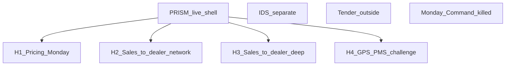

# ISZE BI — portfolio structure

**Role:** BI product map — **four homes** inside a **PRISM shell**; Monday Command killed; IDS and tenders out  
**Updated:** 2026-09-06 (H1 Monday product killed)  
**Census:** [`BI_DASHBOARD_CENSUS_2026-09-06.csv`](BI_DASHBOARD_CENSUS_2026-09-06.csv)  
**Claim gate:** [`GPS_PMS_V2_CLAIM_FRAMEWORK.md`](GPS_PMS_V2_CLAIM_FRAMEWORK.md)  
**Ops rules:** [`ISZE_BI_OPTIMIZATION_FRAMEWORK.md`](ISZE_BI_OPTIMIZATION_FRAMEWORK.md)  
**Next deepen (H4 · P4 · H2/H3; H1 skipped):** [`NEXT_DEEPEN_BRIEFS_2026-09-07.md`](NEXT_DEEPEN_BRIEFS_2026-09-07.md)

**Hard locks**

- **Monday Command / mega “ops home” = killed.** No weekly leakage command center.
- **Monday work = pricing** (Book B / revision / Action Map).
- **Sales to dealer** = meeting packs only (network + deep) — not a weekly home.
- **IDS** = separate project. **Tenders** = outside BI.
- Static HTML = share/deck; **PRISM** organises the four stories live.
- SPAR default: chat until Jerome says `rebuild` / `ship` in that message.

---

## 1. Architecture

| Home | Plain English | Primary HTML / live |
|------|---------------|---------------------|
| **H1 Pricing (Monday)** | What price / Book B actions this week | Action Map · Command Center **Pricing** tab (default) |
| **H2 Sales to dealer — network** | AIM/GPS for every DB with files | `Dealer_Sellout_AIM_GPS_Sales_to_Dealer_2025.html` |
| **H3 Sales to dealer — deep** | One DB / layered deep dive | SixDB · PartGroups · Replenishment |
| **H4 GPS/PMS challenge** | Mileage-true capture (Mode B) | CC **GPS/PMS V2** tab · claim framework |

**Killed:** Monday ops / stale-aware leakage mega home.  
**Out of BI:** IDS · Tender Monitor · thin `bi/` twins · `02_dashboards/Data/` mirror junk.  
**Fleet UIO** = input to H4 — not a fifth BI door.

---

## 2. Monday = pricing only

Purpose sentence (locked): *Monday exists so Jerome can decide price / Book B / revision actions using list and billing-derived queues that stay usable without fresh dealer sales.*

Sales-to-dealer leakage may still appear inside Command Center as an **archive / meeting** panel with DATA AS-OF — never as the product name or default Monday tab.

---

## 3. H2 / H3 — Sales to dealer

**Name:** Sales to dealer (StD).  
**DBs:** ITUK · UTI · IRELAND · IUK · GREECE · PORTUGAL.  
Do not title ITUK/UTI-only. GREECE amber when peer sell-out missing. One grain per meeting for H3.

---

## 4. H1 — Pricing execution quality

Before “undercut / leakage / ambition” conclusions:

1. List vintage / PR00 date  
2. Reference sell-out = PR00 × **1.785** (never “street” in UI)  
3. IAM match coverage % before undercut claims  
4. UTI ≠ UMI · IUK ≠ ITUK · IRELAND ≠ IUK  
5. Ambition € vs guardrail-blocked €  

---

## 5. H4 — GPS/PMS challenge

Mode B only. Claim framework mandatory. No sticky header covering rows; boss-readable captions.

---

## 6. PRISM shell

PRISM `:8503` page `25_BI_Homes` = live organiser of **four** homes. BI_PACKS = secondary static index. IDS/tender not BI doors. Monday Command not listed.

---

## 7. Boss-readable summary

BI is four tools inside PRISM: Pricing (what you do on Monday), Sales to dealer network, Sales to dealer deep, GPS/parts challenge. The old Monday Command Center-as-product is gone. Dealer scorecards (IDS) and tenders stay outside.

**What is left (2026-09-07 pick):** deepen H4, P4, and H2/H3 inside those homes — not H1, not a fifth file. Briefs: [`NEXT_DEEPEN_BRIEFS_2026-09-07.md`](NEXT_DEEPEN_BRIEFS_2026-09-07.md). SPAR until `rebuild` / `ship`.
