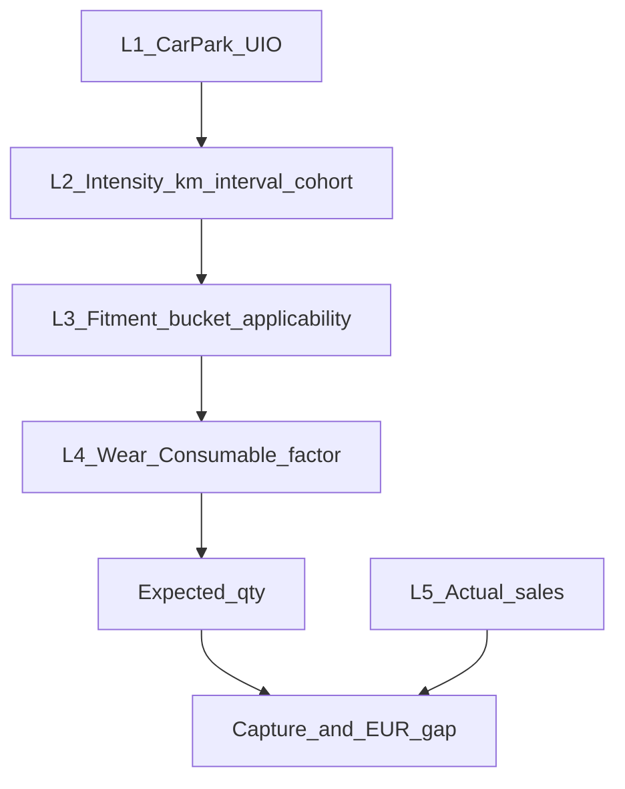

# GPS / PMS V2 — claim & comparison framework (Mode B)

**Role:** SSOT for what may be claimed when comparing V1 ↔ V2 or citing EQ-HIT / mileage / Opt2/3  
**Updated:** 2026-09-05  
**Audience:** Jerome / agents · Mode B only  
**Companion status:** [`GPS_PMS_V2_SPEC.md`](GPS_PMS_V2_SPEC.md) · formula: [`GPS_PMS_V2_CONCEPT.md`](GPS_PMS_V2_CONCEPT.md)

**Locked (do not redefine here):** V1 published / V2 shadow; primary capture = **total** sales; Trooper interval = RT; oil not in EQ-HIT extract; car park still V19.

Reject a bad analysis in one line: **fails contract X / grade Y**.

---

## Why this exists

Fail modes this framework kills:

- Cross-metric “ranking flips” (V1 €/UIO vs V2 wallet index)
- Selling clutch € gap as EQ-HIT news when V1 already had the same shape
- Reading `fitment_weight=1` as “every VIN needs a clutch this year”
- Celebrating capture >100% without seed-bias check

---

## A. Truth stack — five layers, never conflate

| Layer | Question | V1 today | V2 shadow today | May claim as “proven”? |
|-------|----------|----------|-----------------|------------------------|
| **L1** Car park | How many vehicles, which gen/age? | Flat LCV UIO V19 | Same + Opt2/3 only IE/PT | **No** — V20 not applied; almost no rank A |
| **L2** Intensity | Services/yr | Flat bucket svc | DB LCV km ÷ interval + cohort | Mileage map = observed sample; interval = locked assumption |
| **L3** Fitment | Does part **family** apply to bucket? | BVP binary | BVP + EQ-HIT seed overlay | Applicability only — **not** “needs replace this year” |
| **L4** Wear / consumable | Fraction of service-years that buy the part | Same factors (e.g. clutch **0.2**) | Same factors | **Assumption** until IML/field validates |
| **L5** Actual | What sold | SAP/PMS actuals | Same actuals | **Yes** (qty/€) |

**Rule:** A conclusion must name which layer moved. If only L2 moved, do not credit L3/L4.

---

## B. Metric contracts (apples only)

Each metric has a **legal pair**. Illegal pairs are banned in chat, packs, and BI copy.

| Metric | Formula | Legal compare to | Illegal |
|--------|---------|------------------|---------|
| Capture V1 / V2 | actual ÷ expected_(v1\|v2) | Same category, year, `line_type=total`, other capture | Wallet, €/UIO, traffic light |
| € gap V1 / V2 | (exp − act) × avg SP | Same as above, **same expected version** | Mixing gap_v2 with exp_v1 |
| €/UIO | (defined V1 GPS sales) ÷ UIO | Other DBs’ €/UIO only | Wallet index |
| Wallet index | PMS-basket actual € ÷ Σ(exp_v2 × SP) | Other DBs’ wallet index only | €/UIO, capture % |
| Opt2/3 capture | Same as capture but Opt denominator | Same DB Opt1 vs Opt2 vs Opt3 | Network KPI as if Opt2 is live everywhere |

### Mandatory comparison table

**Before** any “movers / contested / ranking” prose, fill:

| category | exp_v1 | exp_v2 | actual | cap_v1 | cap_v2 | gap_v1_eur | gap_v2_eur | Δexp_driver |
|----------|-------:|-------:|-------:|-------:|-------:|-----------:|-----------:|-------------|

`Δexp_driver` ∈ {`mileage`, `cohort`, `fitment_flip`, `wear_unchanged`, `mixed`} — by attribution, not vibes.

---

## C. Evidence grades (every claim tagged)

| Grade | Meaning | Examples |
|-------|---------|----------|
| **A** | Observed | Actual qty/€; EQ-HIT row counts; mapped km from EU Mileage file |
| **B** | Locked business assumption | LCV interval 20k; Trooper=RT; IUK CY2026F 44,926 for GPS |
| **C** | Provisional model | Clutch wear 0.2; F-series svc; wallet basket definition |
| **D** | Seed / stub / biased | 37 PN extract; brake pad LCV→0 on N-series seeds; categories still BVP |

**Publish rule:** Headline conclusions need **A or B** for the **driver** layer. Grade **C/D** may appear only as sensitivity or caveat — never as “we know.”

---

## D. Claim templates (allowed) vs banned phrases

### Allowed

- “Under V2 mileage expected, oil network capture falls from X% to Y% (same actual).”
- “Clutch disc gap is €A under V1 expected and €B under V2; ratio clutch/oil expected stays 0.20 — wear model unchanged; EQ-HIT did not flip clutch fitment vs BVP.”
- “Fitment=1 means bucket applicability, not annual replacement need.”

### Banned

- “All VINs need a clutch”
- “EQ-HIT shows €X clutch opportunity” (without V1 baseline on the same metric)
- “V1 green / V2 empty wallet” as one table without metric contract
- “Car park is fixed”
- Capture >100% as success without Grade D seed-bias note

---

## E. EQ-HIT role (narrow)

EQ-HIT may change a conclusion **only if**:

1. `weight_changed_vs_bvp` for that category×bucket, **or**
2. It blocks a false BVP assumption you were about to publish

Otherwise: label as **V1 restated under mileage** (L2), not fitment insight (L3).

**Oil:** explicitly out of extract — Opt1 oil = **L2 only**.

---

## F. Dig protocol (after Jerome says dig)

1. State hypothesis + which layers/metrics (from contracts above)
2. Fill mandatory comparison table
3. Tag each conclusion A–D
4. Separate “V1 baseline” vs “V2 delta” vs “EQ-HIT delta”
5. Only then optional sensitivity (e.g. clutch wear 0.1 / 0.2 / 0.3) as **Grade C band** — not new headline fake precision

Until dig is authorized: no shadow rebuild, no EQ-HIT pull, no BI edit, no new derived CSVs for “more analysis.”

---

## Acceptance

This doc answers in one page each: (1) truth stack, (2) metric contracts + banned pairs, (3) evidence grades, (4) EQ-HIT claim gate, (5) mandatory V1↔V2 table shape.
