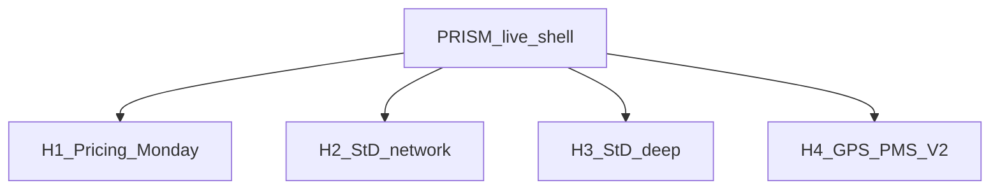

# ISZE BI optimization framework (Mode B)

**Role:** Operating rules for BI homes — deepen, don’t fork  
**Updated:** 2026-09-06 (Monday Command killed · four homes)  
**Audience:** Jerome / agents  
**Structure SSOT:** [`BI_FULL_AUDIT_AND_STRUCTURE_2026-09-06.md`](BI_FULL_AUDIT_AND_STRUCTURE_2026-09-06.md)  
**Claim gate:** [`GPS_PMS_V2_CLAIM_FRAMEWORK.md`](GPS_PMS_V2_CLAIM_FRAMEWORK.md)

**Ban:** New standalone HTML for a question that already has a home. **IDS and tenders are not BI doors.**  
**Ban:** Resurrecting Monday Command / stale-aware leakage mega as a BI home.

---

## 1. Audience × job × home

| Audience | Job | Home |
|----------|-----|------|
| Jerome Monday | Price / Book B / revision actions | **H1** Pricing (Action Map · CC Pricing tab) |
| Commercial / network | Sales to dealer mix + GPS lens | **H2** StD network HTML |
| DB deep work | Bill vs dealer sales layers | **H3** SixDB / PartGroups / replenishment |
| Internal challenge | Mileage-true PMS/GPS | **H4** CC V2 tab |
| Live navigation | All of the above | **PRISM shell** |
| Dealer workshops | IDS | **Out** |
| Tender eyes | Tender monitor | **Out** |

---

## 2. Pack registry

### Keep / deepen (BI)

| Pack | Status | Home |
|------|--------|------|
| Command Center — **Pricing tab default** | **DEEPEN** as H1 shell (+ H4 V2 tab) | H1 + H4 |
| Pricing Action Map | **KEEP** | H1 |
| IAM / Live Pricing / History | **KEEP** pick-one | H1 specialists |
| Dealer Sellout AIM/GPS (all StD DBs) | **KEEP** | H2 |
| Next Analyses Six-DB | **KEEP** | H3 |
| PartGroups / Replenishment | **KEEP** | H3 grain |
| Fleet GPS / UIO | **KEEP** as V1 + H4 input | not a BI door |
| BI_PACKS | **KEEP** under PRISM | index |
| PRISM `25_BI_Homes` | **SHELL** | four homes |

### Out / killed

| Pack | Rule |
|------|------|
| Monday Command / ops mega home | **Killed** — do not re-list as H1 |
| All `ids/**` | Separate IDS project |
| Tender Monitor | Outside BI |
| `bi/` thin twins | Redirect to H2/H1/PRISM |
| `02_dashboards/Data/**` | Mirror junk |

---

## 3. Claim + pricing gates

- V1/V2/wallet/EQ-HIT → claim framework  
- Pricing conclusions → list date, ×1.785, IAM coverage, DB locks  
- PMS headline = **total** capture · no “street” in UI  

---

## 4. Visual sales canon

1. One hero question  
2. Three numbers max (same family)  
3. One ranked chart  
4. Narrative top-3  
5. Action list ≤5  
6. Empty = amber banner  

**Banned:** sticky overlay · agent slang captions · genuine-only PMS headline · fake-fresh StD as Monday product.

---

## 5. Sales-to-dealer in Command Center

StD panels = **archive / meeting** with DATA AS-OF. Never default Monday tab. Never product title “Monday Command.”

---

## 6. Sales to dealer DB coverage

On-disk: **ITUK, UTI, IRELAND, IUK, GREECE, PORTUGAL**. No ITUK/UTI-only titles.

---

## 7. Underused data → home

| Data | Home |
|------|------|
| revision / Book B / IAM | H1 |
| StD longs / AIM/GPS | H2 / H3 |
| `next_analyses_*` | H3 |
| `pms_v2_*` / EQ-HIT / mileage | H4 |
| IDS / tender | **Not BI** |

---

## 8. Agent decision rule

Ask → **“home = Hx (or out / killed), deepen …”** — never a new filename by default. SPAR until `rebuild`/`ship`.

Queued deepen (Jerome 2026-09-07: H4 · P4 · H2/H3; **not H1**): [`NEXT_DEEPEN_BRIEFS_2026-09-07.md`](NEXT_DEEPEN_BRIEFS_2026-09-07.md).

---

## 9. Acceptance

From PRISM: reach four homes in ≤2 clicks. No Monday Command door. Monday entry opens **Pricing**.
