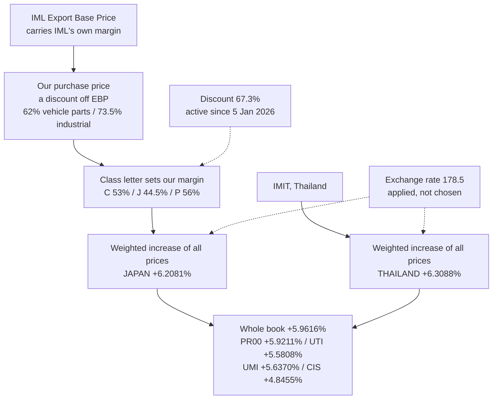

# Pricing programme — roadmap

**Last updated:** 2026-09-19 · **Hub:** [`ISZE_ROADMAP.md`](../ISZE_ROADMAP.md) open-queue item **16** · **Decisions log:** [`DECISIONS.md`](../../DECISIONS.md)

> **Numbers rule:** the figures below are computed, and each one names the file it comes from. Nothing here is quoted from a deck or a memory file.

**How to read this file**

| Section | Use it for |
|---|---|
| [1. Where we are](#1-where-we-are) | The measured position, in one page |
| [2. The decisions](#2-the-decisions) | What needs an answer, and what happens without one |
| [3. Open queue](#3-open-queue) | Work that is buildable, and what blocks it |
| [4. Stale artefacts](#4-stale-artefacts-to-correct-first) | Documents that currently contradict the data |
| [5. Closed — do not reopen](#5-closed--do-not-reopen) | Dead ends. Re-proposing one costs credibility |

---

## 1. Where we are

Measured on the in-scope revision base, window **1 Jul 2025 to 30 Jun 2026**, recipe `in_scope AND unpriced_reason IS NULL` — **47,617 rows**, reproducing the published **5.9616%** index at 1e-6. Source: [`pricing_stack_applied_2026-09-19.json`](../../01_data/00_derived/pricing_stack_applied_2026-09-19.json).

| Measure | Weighted increase | Rows | Weight share |
|---|---:|---:|---:|
| **Whole priced book** | **+5.9616%** | 47,617 | 100% |
| Japan-sourced lines | **+6.2081%** | 22,731 | 47.71% |
| Thailand-sourced lines | **+6.3088%** | 23,085 | 43.08% |
| No source label | +3.0601% | 1,801 | 9.21% |

Per market — UTI is sold-to 1799, UMI is sold-to 1797, and the two are never blended:

| Market | Weighted increase | Billed EUR |
|---|---:|---:|
| PR00 | **+5.9211%** | 12.83M |
| UTI | **+5.5808%** | 3.40M |
| UMI | **+5.6370%** | 2.43M |
| CIS | **+4.8455%** | 1.46M |

**All four markets land in the 5–6% range**, and UTI and UMI are within 0.06 points of each other despite being different distributors with different books.

**The method, because getting it wrong cost two days.** The move is **the weighted increase of all prices, measured** — not a formula with multipliers. Jerome, 19 September: *"you need to look at the weighted increase of all prices not the formula."*

```
weighted increase = SUM(qty x delta_jpy) / SUM(qty x bp_prior) - 1
```

on the published recipe, `in_scope == True` AND `unpriced_reason IS NULL` → 47,617 rows, reproducing the published 5.9616% exactly.

**What went wrong before.** An earlier version multiplied the revision by an exchange-rate factor and a discount factor. **Both were already in force**: 178.5 is what we pay now, and the 67.3% discount has been active since 5 January 2026. Multiplying by them treated settled inputs as forward changes and produced figures as far out as −2.45% on Thailand when the truth is +6.31%.



**The move is the weighted increase of all prices, measured — not a formula with three multipliers.** Jerome, 19 September: *"you need to look at the weighted increase of all prices not the formula."*

The exchange rate 163.7 to 178.5 is what we pay **now**, and the discount at 67.3% **has been active since 5 January 2026**. Neither is a forward change, so neither belongs in the move. An earlier version multiplied by both and got the answer badly wrong.

Measured on the published recipe, `in_scope == True` AND `unpriced_reason IS NULL`, **47,617 rows**, reproducing the published **5.9616%** index exactly:

| Measure | Weighted increase | Rows | Weight share |
|---|---:|---:|---:|
| **Whole priced book** | **+5.9616%** | 47,617 | 100% |
| **Japan (IML)** | **+6.2081%** | 22,731 | 47.71% |
| **Thailand (IMIT)** | **+6.3088%** | 23,085 | 43.08% |
| No source label | +3.0601% | 1,801 | 9.21% |

Per market:

| Market | Weighted increase |
|---|---:|
| PR00 | **+5.9211%** |
| UTI | **+5.5808%** |
| UMI | **+5.6370%** |
| CIS | **+4.8455%** |

**All four markets are in the 5–6% range.** UTI and UMI — sold-to 1799 and 1797, never blended — are within 0.06 points of each other, and CIS is the lowest at +4.85%.

**The correction that mattered most:** Thailand had read as **−2.45%, a price reduction**. It is **+6.31%, a normal increase**. That reversal came entirely from dividing by a rate already in force and multiplying a discount already active. Recorded as errors E23 and E24 in [`ISZE_Agent_Error_Register_2026-09-18_19_v2.xlsx`](../../01_data/90_INBOX/ISZE_Agent_Error_Register_2026-09-18_19_v2.xlsx).

**And the rate is not a decision.** An earlier version of this roadmap proposed a "pass-through dial" for the corporate exchange rate. It is a rate ISZJ gives us and we apply; there is nothing to choose. That framing is removed from every artefact.

**What the base price is, from the mail.** The IML Export Base Price is built up from IML's own costs, and our purchase price is a discount **off** it — Masumi Hayakawa, 10 November 2025: *62% on vehicle parts, 73.5% on industrial engines*, with the worked example EBP 1,000 JPY → 620 JPY purchase. IML also states its own offer is cost plus a target gross profit (Kondou san, 2020: Normal 25%, Best 17%). **So the base price already carries a margin that is not ours**, and the class letter sets our margin on top of it. Two open items follow, both flagged rather than assumed: our configuration applies the **vehicle-parts** rate to everything Japanese while the industrial-engine rate differs (73.5% in 2025, 79.7% in 2026); and IML's own figure for the CY2026 revision is *"around 3%"* against our measured 5.9616%, which needs reconciling rather than explaining away.

**What we hold as evidence.** Tiers T1–T3 — a usable competitor price — cover **880 lines and €5,369,216, which is 16.47% of the priced book**. T4 (category median) adds €1,554,429, taking it to **21.2%**. The remaining **78.8% has no competitor reference at all**. Source: [`_spec_basis_meta.json`](../../02_dashboards/pricing/_build/_spec_basis_meta.json), `tier_counts` / `tier_eur` / `billed_eur_priced`.

**Evidence coverage (no per-line % ceiling).** Only **16.47%** of the priced book has a usable competitor price. The former +8% per-line ceiling is **removed** (Jerome 2026-09-20 — not binding). Under that old illustration, maxing every evidenced line at +8% gave at most **1.32 points** on the whole book — still less than any market needs for a 4% floor. An evidence-only policy therefore cannot close the gap on its own; the remainder would be a blanket move across the 83.5% with no benchmark. That is a decision about method, not a data problem.

**Live inputs, for traceability.** FX **178.5** JPY/EUR, live 1 Oct 2026 to 31 Mar 2027, confirmed in Suzuki san's mail `Exchange revision from Oct 2026` of 15 September 2026, and applying to **both** sources. Purchase discount **67.3%** Japan (**effective 5 January 2026**, per the mail of 22 December 2025), **61.1%** Thailand unchanged. Class factors as issued by IML: C 0.47 (53.0% margin), D 0.48 (52.0%), F 0.525 (47.5%), J 0.555 (44.5%), M 0.50 (50.0%), P 0.44 (56.0%), V 0.55 (45.0%), T 0.80 (20.0%).

---

## 2. The decisions

Seven items. Each is a decision, not effort — the analysis behind each is already done.

### 2.1 The result against the 4–6% band

**There is no band decision to make on this measurement.** The weighted increase is **+5.96%**, and every market lands between **+4.85% and +5.92%** — inside 4–6% without any further action.

| | |
|---|---|
| **Blocked on** | nothing — measured |
| **What to watch** | CIS is the lowest at +4.85%, so it has the least headroom if anything moves |
| **Evidence** | `01_data/00_derived/pricing_stack_applied_2026-09-19.json` |

This replaces an earlier section that proposed a "pass-through dial" for the corporate exchange rate. **The rate is not a decision** — ISZJ gives it and we apply it. There was never a choice to make, and presenting one was an error.

### 2.2 The industrial-engine discount rate

**The question.** Our configuration applies **67.3%** to everything Japan-sourced. That is the **vehicle-parts** rate. IML's own mail of 10 November 2025 states the industrial-engine rate separately: **73.5% in 2025, moving to 79.7% in 2026**. If industrial-engine parts flow through the Japan discount, they are being priced on the vehicle-parts rate.

**Where it came from.** Masumi Hayakawa, `FW: ISZE 移転価格対応 10/30打ち合わせメモ・今後の対応事項につきまして`, 10 November 2025: *"Currently the factors used are 62% on VP and 73.5% on IE, which are applied to IML's Export Base Price (EBP). (ex. EBP 1,000 JPY, ISZE's purchase price for VP is 620 JPY and 735 JPY for IE)."*

| | |
|---|---|
| **Blocked on** | **Jerome** — does any IE volume flow through the pricing stack, and on which rate |
| **Consequence of no answer** | A slice of the book may be priced on the wrong purchase rate |
| **Evidence** | `03_analytics/isze_pricing/config.yaml` → `source_discount.J: 0.673` |

### 2.3 The 3% versus 5.96% gap

**The question.** IML's mail of 10 November 2025 says *"CY2026 IML EBP revision has an impact around 3% increase for ISZE (weighted average)."* We measure **5.9616%** on our own revision base.

**Why it is not explained away.** These are probably different revisions or different scopes — theirs may be a purchase-cost impact over a different window. But guessing which is how the last two days went, so both figures and both sources are recorded and the reconciliation is open.

| | |
|---|---|
| **Blocked on** | **IML** — which revision and which window the 3% refers to |
| **Consequence of no answer** | Two figures circulate for one year's revision and nobody knows which applies |
| **Evidence** | Hayakawa mail 10 Nov 2025, against `aim_pricing_recalc_2026-09-17.json` |

### 2.3 The CIS basis

**The question.** CIS currently prices on the **class factors**, but [`config.yaml`](../../03_analytics/isze_pricing/config.yaml) specifies a **flat 60% margin, class-independent** (`factor_flat: 0.40`, `class_dependent: false`). The configuration also carries a 45% margin where a Chinese equivalent exists and 60% where it cannot be followed.

**This is not a rounding difference.** Measured on the CIS population (CIS-KTK, CBC, GA — 3,090 rows, €1,455,811):

| Basis | Weighted increase |
|---|---:|
| Class factors (current) | **+4.8455%** |
| Flat 60% margin | **+31.2946%** |

**About 26 points apart**, on the same rows. Both are on the sheet because the question is unresolved. Source: `pricing_stack_applied_2026-09-19.json` → `markets.CIS`, and the CIS sheet's own basis-change row.

**A separate blocker inside this one:** the 45%/60% split cannot be segmented today because no part-level file maps a Chinese equivalent to a part number. Until one exists, the split stays a labelled scenario rather than a fact.

| | |
|---|---|
| **Blocked on** | **Jerome** — which basis is real; plus an overlap file for the 45/60 split (does not exist) |
| **Consequence of no answer** | The CIS sheet carries two numbers 28 points apart and neither is authoritative |
| **Evidence** | `03_analytics/isze_pricing/config.yaml` → `markets.CIS` |

### 2.4 The override rows

**The question.** About **12.84%** of rows do not reproduce the price formula — the price on the list was set deliberately rather than derived. Measured: `chain_sp_within_1c_pct_prior_163_7` = 87.16% reproduce, **12.84% do not**, over 275,210 tested rows. Source: [`pricing_framework_maths_proof.json`](../../01_data/00_derived/pricing_framework_maths_proof.json).

**Why it matters.** Nobody has identified who set those prices or on what basis. They are the rows where the computed-margin cross-check is weakest, and where any formula-driven policy is least reliable. The current method reads them correctly — that is the point of reading the price instead of rebuilding it — but the *reason* they exist is unknown.

**Note the label conflict to settle with it.** The framework meta describes the share as **catalogue-wide**; the stack paper describes it as **Japan-specific**. Those are two different measurements using one number. One of them is wrong.

| | |
|---|---|
| **Blocked on** | **Jerome** — data-integrity investigation, or accepted practice |
| **Consequence of no answer** | The weakest eighth of the book stays unexplained |
| **Evidence** | `01_data/00_derived/pricing_framework_maths_proof.json` · `01_data/01_Pricing/_framework_meta.json` line 97 |

### 2.5 Competitor evidence — fund it, or accept 16.5%

**The question.** Only **16.47%** of the priced book has a usable competitor price. Under the **former** +8% per-line ceiling (removed 2026-09-20), that supported at most **1.32 points** on the whole book. Funding wider collection is a resourcing question, not a technical one — brakes proves denser coverage is achievable within one family.

**What we have.** 307 distinct part numbers across every independent source we hold. Brakes is the dense exception. Sources and their vintages: [`competitor_evidence_inventory.csv`](../../01_data/00_derived/competitor_evidence_inventory.csv).

**What we cannot fix by collecting more.** Coverage tells us the competing *price*, not the volume response to ours. Elasticity is not identified on this data at all — IQR 0.69pp and 70.6% of parts within ±1pp of no response. The paper's decision 10 (below) is the only route to that answer, and it is a conversation.

| | |
|---|---|
| **Blocked on** | **Jerome** — fund, or accept 16.5% and say so |
| **Consequence of no answer** | Every policy keeps being argued on a fifth of the book |
| **Evidence** | `02_dashboards/pricing/_build/_spec_basis_meta.json` |

### 2.7 The pass-through question with ITUK

**The question.** What actually happens to the dealer price when our price moves. Policy-paper decision **10**.

**Not to be confused with a pass-through dial.** There is no choice about applying the exchange rate. This is a different question: how our movement propagates along the chain to the dealer. The external review names the risk — a move that protects our margin but destroys the dealer's **converts the dealer into a competitor**, invisibly for one to three years. No model can settle it; it needs a conversation.

| | |
|---|---|
| **Blocked on** | **Jerome** — the conversation |
| **Consequence of no answer** | The whole chain in the paper's section 4 stays arithmetic at a stated assumption |
| **Evidence** | `01_data/92_archive/pricing_papers_superseded_2026-10-02/01_data_90_INBOX/PRICING_POLICY_PAPER_2026-09-17_REV2.md` §11 decision 10 (archived 2 Oct 2026; current paper `02_dashboards/pricing/ISZE_Pricing_Policy_Paper_2026-10-02.html`) |

### 2.7 Class assignment

**The question.** Whether we have a voice in class assignment and in the base price. Policy-paper decision **6**, and the external review calls it the **single highest-leverage item**.

**Why.** The margin is set by a class letter, so **class assignment is margin assignment** and it fixes the margin for the life of a part. For a new part number it is a one-time decision worth more than several years of percentage increases. 80% of a catalogue is priced by a rule, so whoever assigns the class assigns the price.

| | |
|---|---|
| **Blocked on** | **Jerome** — whether we have a voice, and with whom |
| **Consequence of no answer** | We keep negotiating percentages on a margin somebody else set |
| **Evidence** | `PRICING_POLICY_PAPER_2026-09-17_REV2.md` §11 decision 6 |

### Also open from the policy paper

Decisions 1–5, 7–9, 11, 12 in [`PRICING_POLICY_PAPER_2026-09-17_REV2.md`](../../01_data/92_archive/pricing_papers_superseded_2026-10-02/01_data_90_INBOX/PRICING_POLICY_PAPER_2026-09-17_REV2.md) §11. Not repeated above because they are stated there in full. The two that most change what happens next are **decision 3** (settle the FY2027 ambition before or after the 20% distributor support payment — it flips a +4% headline to +3.2% net) and **decision 8** (top 200 part numbers by revenue against criticality and competition, which needs no new data).

---

## 3. Open queue

Numbered from **16**, continuing the hub's sequence. Only buildable work belongs here.

| # | Item | State | Blocked on |
|---|---|---|---|
| 16 | **This roadmap** — the pricing programme | Live 2026-09-19 | Jerome on items 2.2, 2.3, 2.4, 2.5, 2.7, 2.8 |
| 17 | **The industrial-engine discount rate** | Our config applies the vehicle-parts rate (67.3%) to everything Japan-sourced; IML states the IE rate separately (73.5% → 79.7%) | Jerome — does IE volume flow through the stack |
| 18 | **Reconcile the 3% against our 5.9616%** | IML's own figure for the CY2026 revision is "around 3%"; we measure 5.9616%. Different scope, or different revision | IML — which window the 3% covers |
| 19 | **Re-derive the brakes 82.6%** | Prose only in the policy-paper builder; no CSV or builder computes "311 of 334, €2,596,458" | nothing — re-derive or cite as unsourced |
| 20 | **Settle the FX stamp on published packs** | Policy-paper decision 9 — every competitive comparison without a rate stamp is against a moving floor | nothing, once the rate is fixed |
| 21 | **The no-source-label rows** | 1,801 rows, 9.21% of index weight, €2.94M billed, 656 part numbers. They carry a weighted increase of +3.06%, well below both sources | nothing — resolve the labels or keep reporting them separately |

**Not on this list on purpose:** anything in section 5.

**Not on this list on purpose:** anything in section 5.

---

## 4. Stale artefacts to correct first

Cheap, and each currently misleads anyone who reads it.

| Artefact | What is wrong |
|---|---|
| [`PRICING_STACK_APPLIED_2026-09-19.md`](../../01_data/90_INBOX/PRICING_STACK_APPLIED_2026-09-19.md) | Describes a `Provenance` column and `J99`/`T99`/`X99`/`CIS` codes. Both were removed at Jerome's instruction — the workbook carries his `J`/`T` in the `Source` column. The document contradicts the workbook |
| [`DECISIONS.md`](../../DECISIONS.md) | No entry for this session. The 2026-09-17 entry still says the exchange-rate fork "stays open" at 163.7, which is superseded |
| [`build_pricing_policy_paper.py`](../../01_data/92_archive/pricing_papers_superseded_2026-10-02/02_dashboards_pricing_build/build_pricing_policy_paper.py) lines 1293–1318, 1396 | The brakes 82.6% / "311 of 334" / €2,596,458 is authored prose with no deriving source |
| [`_framework_meta.json`](../../01_data/01_Pricing/_framework_meta.json) line 97 vs the stack paper | The override share is stated catalogue-wide in one and Japan-specific in the other |

---

## 5. Closed — do not reopen

All closed in [`ISZE_ROADMAP.md`](../ISZE_ROADMAP.md) §5 or `DECISIONS.md`. Re-proposing one of these costs credibility.

| Closed | Reason |
|---|---|
| **The price adjustment ambition** (+4% / +5% / launch-only) | **Closed 2026-09-22, permanently.** Jerome, verbatim: *"delete price ambition I will come when it's done for now do a simulation on 5% increase and than never ask again."* The +5% flat simulation of 2026-09-22 is its last output. **Never re-ask in any form.** Record: [`PRICE_AMBITION_CLOSED_2026-09-22.md`](../PRICE_AMBITION_CLOSED_2026-09-22.md) |
| **Gross / SPA / condition columns on the billing extract** | `sales_fact` is net-only forever. Do not re-ask |
| **AIM pricing-risk as a decision surface**, and any new 0–100 score | Gate never fired; fitted replacements failed holdout. 2026-07-17 / 2026-08-18 |
| **`db_aftersales_risk`** as its replacement | Parked 2026-08-18 |
| **ISZE→DB `price_volume_elasticity.csv`** | Deferred. Resumes only as DB→DLR when dealer sales-to-dealer coverage improves |
| **Autodoc / Oscaro scraping** | Cloudflare-blocked, permanently. 2026-07-14 |
| **Auto365 as a part-number price index** | No OEM part-number join exists |
| **An external "healthy capture %" as an ISZE target** | Three different metrics; none is an ISZE target |
| **The AIM attribute layer** | On hold per Jerome 2026-09-17. Hub open-queue item 15 |

---

*Created 2026-09-19. Every figure in this file was computed from the file named beside it. The position and the per-market weighted increases reproduce from `01_data/00_derived/price_bp_weighted_compare_pn.csv` filtered to `in_scope == True` AND `unpriced_reason IS NULL`, and are verified independently. The evidence tiers reproduce from `02_dashboards/pricing/_build/_spec_basis_meta.json`. Nothing was rebuilt, published or mailed to write this roadmap.*
