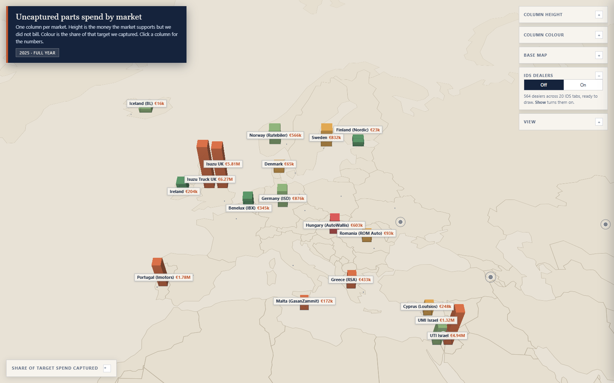

# ISZE Globe

An interactive 3D globe where each market is a column standing on the map.
Column **height** is one measure, column **colour** is a second measure, and
clicking a column opens that market's numbers. A second layer, off by default,
puts the **IDS dealer network** on the same globe.

Status: **internal prototype, Jerome only.** Not a shared pack. The honesty of
the labels is deliberate — where a figure is missing, the page says so instead
of showing a zero, and where a dealer's position is approximate, the pin and the
panel both say so.



---

## How to run it

Double-click:

```
C:\Users\jerom\Desktop\claude\ISZE\02_dashboards\globe\OPEN_ISZE_Globe.cmd
```

**Do not double-click `index.html`.** It will not work, and that is expected,
not a bug. Two separate browser rules block it:

1. MapLibre GL JS does its geometry work in a **Web Worker**, and browsers
   refuse to start a Worker from a `file://` page.
2. The page reads its numbers with `fetch()`, which `file://` blocks as well.

The launcher starts a small local web server and opens the page over
`http://localhost:<port>`. It picks port 8511, and if that port is already busy
it walks up to the next free one instead of failing. A minimised `python`
window holds the server; close it when you are finished.

### Prerequisites

Python on `PATH` (the machine already has it) and a browser with WebGL. Nothing
to install, no account, no token.

---

## What the page does

- **Globe projection.** MapLibre's `projection: { type: 'globe' }`. Verified as
  actually spherical, not just requested — see *Verification* below. A toolbar
  switch drops to a flat map if you want to compare.
- **One column per market.** MapLibre has no point-column layer, so
  `build_market_spine.py` generates a small square polygon per market
  (120 km across, sized in ground kilometres so it does not distort with
  latitude) and the page draws them with a `fill-extrusion` layer.
- **Offline base geography.** Land and country borders come from a local file
  (`data/basemap_land.geojson`, Natural Earth, copied from the existing IDS
  master map assets). The globe paints with the network off.
- **Live streets as a switch, not a requirement.** The *Live streets* button
  adds CARTO Voyager raster tiles and nothing else. The offline geography stays
  underneath, so a blocked tile server degrades to "no street detail" rather
  than a blank globe. See *Live tiles: why only CARTO* below.
- **The IDS dealer layer.** 564 dealers, off by default, drawn from zoom 5
  upwards, coloured by their score against their own national average. See
  *The IDS layer* below.
- **Labels.** Every column is labelled with its market name and its height
  value, drawn as HTML over the canvas — a MapLibre text layer would need font
  glyphs fetched from a server, and this page has no network dependencies.
  Labels collide-test each other and stack rather than disappear, so both
  markets in a shared-coordinate pair stay named. The dealer cluster counts are
  placed first and the market labels give way to them, so the two sets never
  overprint.
- **Click for the panel.** Market name, country, region, year, the euro gap,
  what was billed, the target spend, the capture rate, spend per truck, the
  fleet behind it, the parts-market-scan capture, and an explicit list of what
  is not wired yet.
- **Calculated numbers explain themselves.** Every derived figure carries a
  hover explanation of its formula and period, not just a bare percentage.
- **Overlays fold.** The controls and the legend each fold to their header. On a
  window shorter than about 1010 px the legend opens folded, so the map is not
  covered on first paint; turning the dealer layer on unfolds it again.

---

## The data

| File | Role |
|---|---|
| `01_data/00_derived/gps_spu_by_distributor.csv` | the measures (GPS parts spend) |
| `03_analytics/Isuzu/prism/data/distributor_geo.csv` | coordinates per distributor |
| `01_data/00_derived/pms_capture_by_db_year.csv` | the panel's parts-market-scan numbers |
| `01_data/00_derived/distributor_dimension.csv` | display name, region, entity mapping |
| `02_dashboards/ids/IDS_2026_dealer_compare.html` | the IDS dealer records, read only |

**All four market files join on `distributor_code`, with no crosswalk table
needed.** The entity file also carries `payer_code`, and `build_market_spine.py`
deliberately joins on `distributor_code`/`sold_to_sap` rather than `payer_code`,
because payer 1797 covers two different Israel businesses. The build verifies
that UMI resolves to `sold_to_sap` 1797 and UTI to 1799, and **refuses to build**
if that ever stops being true, so UMI and UTI can never be silently blended.

**Reporting period: 2025, full year.** This is the most recent year that both is
complete and carries a target spend. 2026 exists but is `partial_year`, and
2023–2024 have no `max_spend_eur`. Putting a part-year next to full years would
compare unlike periods, so partial rows are excluded from the map.

### Columns: 18 markets

18 of the 22 full-year 2025 markets have a usable target spend and get a column.
The other 4 — **Armenia, Kazakhstan, Palestine, Ukraine** — have no modelled
target spend in the source. They are drawn as flat grey ringed markers, labelled
"no target spend", and their panel says plainly that the figure is missing
rather than zero. They are not silently dropped and not given a fake column.
Their four labels are hidden at the default Europe view (they are drawn and
clickable, and their panel still explains the gap) because those four labels
were what tipped the middle of the map into a wall of text; they appear once
zoomed past zoom 4.0.

### Height: the uncaptured euro gap

`height = sqrt(gap ÷ largest gap)`, scaled between a **35 km base** and a
**700 km peak**. The gap runs from €16,218 (Iceland) to €6,271,367 (Isuzu Truck
UK) — a 387-fold spread. On a plain linear scale the smallest fifteen markets
would be a flat line, so the square root compresses the range, and the 35 km
floor is what keeps a small gap visible and clickable.

### Colour: share of target spend captured

Five classes, with the breaks placed in the gaps between the natural clusters in
the 2025 data rather than on round numbers:

| Colour | Class | Markets |
|---|---|---|
| `#b23a3a` | under 40% captured | 1 (Hungary 35.4%) |
| `#c0552d` | 40% to 55% | 6 |
| `#d99a3c` | 55% to 70% | 4 |
| `#7fa96b` | 70% to 85% | 4 |
| `#3f7d4f` | 85% or more | 3 |
| `#6b7280` | no value in the source | 4 |

### The metric switch

The measure driving height and the measure driving colour are **not hardcoded in
the page**. They are named in `settings.height_metric` and
`settings.color_metric` inside `data/market_spine.json`, and a registry in the
same file describes every plottable measure with its own label, unit, scale and
class breaks. Change those two keys and rebuild, and the same page renders a
different measure with a matching legend and tooltips — no edit to `index.html`.

Live options in the dropdowns: uncaptured parts spend, share of target captured,
what we billed per truck, parts billed, target spend for the market.

For a quick look without rebuilding, the page also accepts a URL override:

```
index.html?height=spend_per_unit_eur&color=gap_eur
```

### Two markets share a coordinate — handled, not hidden

`distributor_geo.csv` puts **ITUK and IUK** on the same point (54.0, -2.0), and
**UMI and UTI** on the same point (31.05, 34.85). Two columns stacked on one
point cannot be read as two markets. The build spreads each pair **160 km apart**
along longitude, in ground kilometres so the offset does not distort with
latitude, and labels both. The panel for both members of a pair carries a
"shares a coordinate" chip and a sentence naming the other market.

`UNMAPPED` has empty coordinates and is excluded; the build log records it.

---

## The IDS layer

**IDS is the Isuzu Dealer Standard**: an annual dealer evaluation of the
European and Israeli distributor networks. Each dealer scores a percentage of
the points available, has a rank, a national average for its own country, and
per-section scores A–E.

### Where the dealer records come from

`extract_ids_dealers.py` reads the JSON payload already embedded in
`02_dashboards/ids/IDS_2026_dealer_compare.html` and writes a compact copy to
`data/ids_dealers.json`. It does not re-run the geo resolver: those coordinates
have already passed the workspace's own geo checks and are the same pins the IDS
map draws, so re-deriving them would risk disagreeing with the IDS master.
`02_dashboards/ids/` is an **input only**; nothing there is modified.

The extracted file is **461 KB, down from 4.4 MB**, because the per-question
array (`q`, 196 floats per dealer, about 3.4 MB across the network) is dropped.
The globe panel does not show per-question detail and the full view already
exists in the IDS dealer compare.

### 564 dealers, and 20 IDS tabs

| Tab | Dealers | Tab | Dealers |
|---|---|---|---|
| France | 84 | Poland | 23 |
| Spain | 45 | Switzerland | 22 |
| United Kingdom (light commercial) | 45 | Denmark | 20 |
| United Kingdom (trucks) | 44 | Hungary | 19 |
| Benelux (Belgium, Netherlands, Luxembourg) | 43 | Portugal | 16 |
| Italy | 41 | Romania | 15 |
| Norway | 38 | Netherlands | 9 |
| Belgium | 34 | Cyprus | 1 |
| Greece | 34 | Luxembourg | 1 |
| Israel (UMI) | 29 | Malta | 1 |

**Israel is UMI only.** The IDS Israel network is the UMI dealer network; UTI did
not take part in that IDS round. Nothing from UTI is in this file, because the
file only carries IDS participants, and the country is labelled "Israel (UMI)".
`check_ids.py` asserts that no UTI dealer appears.

### Real coordinates versus approximate ones

The IDS build records **how each pin's position was derived** in a `geo_label`.
That field is carried through unchanged, because it is the honesty signal:

| `geo_label` | Dealers | Drawn as |
|---|---|---|
| Approx city from address | 225 | approximate |
| **Approx city (MIDI network)** | **160** | **surveyed** |
| Approx city from dealer name | 100 | approximate |
| Approx city (directory / known place) | 67 | approximate |
| Approx country centre (no city in name) | 9 | approximate |
| Overseas territory (French DOM-TOM) | 3 | approximate |

Only the **160 MIDI-sourced** pins (France, Spain, Italy — the MIDI network
survey) sit on real surveyed coordinates. The other **404** are town-level or
worse, including nine placed on a country centre. The map draws them
differently — a solid ring for surveyed, a broken ring with a pale centre for
approximate — and every panel states which note its own position came from. The
dealer key says the same in words. Presenting all 564 as if they were addresses
would be a lie, so the two kinds are not merged.

### How the layer behaves

- **Off by default, and drawn only from zoom 5.** At the default Europe view the
  market columns stay the primary mark, so 564 pins never clutter the top view.
  The page opens at about zoom 3.1.
- **Turning it on answers with the dealers.** If you turn it on while zoomed
  out, the camera moves to zoom 5 centred on the dealer network. (The Europe
  frame itself is set by the 18 market columns and does not include the French
  overseas dealers; the dealer view fits all 564.)
- **Clustered up to zoom 7.** France alone has 84 dealers and several towns hold
  more than one, so without grouping a country view is a pile of overlapping
  dots. A group is a navy disc carrying its count; clicking it moves in until
  the pins separate. Above zoom 7 the individual pins are drawn.
- **Colour is the band against that dealer's own national average**, using the
  same ±3 percentage points the IDS dealer compare uses, so the two pages agree
  on which dealers are above and below: green above, amber near, red below.
- **No 564 labels.** The only dealer-related DOM nodes are cluster counts, and
  only for groups big enough to win a spot that collides with nothing. At zoom
  6.4 over France that is 26 nodes for 564 dealers.
- **The panel** shows dealer name, country, total score, the national average,
  the difference in percentage points, all five sections with their own national
  averages, and the honest note about the position. It does **not** draw a radar
  or a per-question view; it names
  `02_dashboards/ids/IDS_2026_dealer_compare.html`, which already has both for
  all 564 dealers.

---

## Files

```
02_dashboards/globe/
  OPEN_ISZE_Globe.cmd          launcher (CRLF, double-clickable)
  run_globe_server.ps1         starts the server, finds a free port, waits for it
  index.html                   the page
  build_market_spine.py        builds data/market_spine.json
  extract_ids_dealers.py       builds data/ids_dealers.json (reads the IDS page)
  prep_basemap.py              builds data/basemap_land.geojson
  _ui/maplibre-gl.js           vendored MapLibre GL JS 5.6.2 (UMD)
  _ui/maplibre-gl.css          vendored MapLibre GL JS 5.6.2 stylesheet
  data/market_spine.json       the market numbers the page fetches
  data/ids_dealers.json        the IDS dealer records the page fetches
  data/basemap_land.geojson    offline geography
  _qa/                         screenshots, checks, QA note
  README.md                    this file
```

### Rebuilding the data

```
python 02_dashboards/globe/build_market_spine.py     # the market numbers
python 02_dashboards/globe/extract_ids_dealers.py    # the IDS dealer records
python 02_dashboards/globe/prep_basemap.py           # the geography (rarely needed)
```

All three use only the standard library plus pandas. None touches any file
outside this folder, and `extract_ids_dealers.py` only reads the IDS page.

### Live tiles: why only CARTO

The live layer lists two CARTO Voyager mirrors of the same map and nothing else.

This matters because **MapLibre walks a raster `tiles` array by tile sequence to
spread load across mirrors; it does not treat later entries as fallbacks.** That
was measured on 5.6.2 rather than assumed: with one dead URL followed by a live
one, both were requested for different tiles and the dead one produced an error
rather than being skipped. So every tile service listed is a service the user
actually sees, accounting for a share of the tiles.

An earlier version listed **Esri World_Street_Map** third. Esri now stamps tiles
served without an API key with the words *API KEY REQUIRED* in large diagonal
text, which painted across roughly a third of the basemap. The source is
**removed rather than keyed**: the workspace uses no Esri service and has no Esri
account. A second, different keyless provider (OpenStreetMap's standard tiles)
was considered and deliberately not added — OpenStreetMap's tile usage policy
expects low-volume, non-commercial use and discourages applications, and mixing
providers would also make the attribution and the reachability probe describe
something other than what is really drawn. CARTO alone is keyless, matches the
house look, and is enough.

MapLibre itself stays pinned at **5.6.2, vendored as a local file. Version 6 is
ESM-only and its UMD build no longer exists**, so the `<script src>` pattern this
page uses would break. There is no CDN reference to MapLibre anywhere in
`index.html`.

To re-fetch the vendored files:

```
curl -L -o _ui/maplibre-gl.js  https://unpkg.com/maplibre-gl@5.6.2/dist/maplibre-gl.js
curl -L -o _ui/maplibre-gl.css https://unpkg.com/maplibre-gl@5.6.2/dist/maplibre-gl.css
```

---

## Not wired yet

These are listed on every market panel under "Not in this map yet", and nothing
here is estimated to fill the gap:

- **Warranty parts.** Source sits with IMG, market-level only, on three
  conflicting euro bases. Not reconciled, so not plotted.
- **Fleet size workbook (UIO).** Needs a name crosswalk to distributor codes
  before its counts can join this map.
- **Price revision.** Separate track, no market-level figures wired here.
- **Live tenders.** Tracked elsewhere, not keyed to `distributor_code`.
- **Sales to dealer.** Only partial coverage across these markets; would compare
  unlike things.

Also not modelled: any per-part-family column breakdown on the globe itself. The
three largest-gap families appear in the panel, off the parts-market-scan total
line only.

The dealer side has its own gaps, and they are stated on the panel rather than
filled in:

- **Per-question scores on the globe.** Deliberately left out of the file the
  globe reads — they already exist in the IDS dealer compare.
- **A radar on the globe.** Deliberately not drawn, for the same reason.
- **A dealer's rank** is not carried into the extracted file. The panel shows the
  score, the national average and the difference; the ranking sheet is in the
  IDS compare.

---

## Language rules followed

This is an internal artifact, but the house rules are followed anyway:

- Parts sold to a dealer are called **sales to dealer**.
- Parts spend is **what we billed** versus **target spend per truck**.
- Audience labels are **shared/external** and **internal/private**.
- Pricing language uses **reference dealer price**, and margins rather than
  factors.
- A quantity is never a finding on its own: every gap carries euro, the part
  family, and the fleet denominator beside it, and no panel leads with a unit
  count.
- Acronyms get one plain-English gloss on first use — GPS, PMS, UIO, DB and IDS
  are all explained, IDS in the dealer key and on every dealer panel.

One note on wording: the basemap toggle is labelled **Live streets**. That is map
geography, not commercial pricing language.

---

## Verification

Builder exit code 0 proves nothing, so the page was loaded over
`http://localhost:8511` in headless Chrome and inspected. The checks live in
`_qa/` and are re-runnable:

```
powershell -NoProfile -ExecutionPolicy Bypass -File run_globe_server.ps1
python _qa/qa_globe.py          # drives the page, writes screenshots 01-21
python _qa/check_spine.py       # 45 assertions on the built market JSON
python _qa/check_ids.py         # the IDS file and the IDS layer, by count
python _qa/check_html.py        # inline-script syntax, element ids, banned words
python _qa/check_layout.py      # label overlaps, clipping, panel and overlay geometry
python _qa/verify_encoding.py   # sphere test + per-column colour check
python _qa/check_offline.py     # network blocked; also the live-watermark test
python _qa/pixel_check.py       # are there actually coloured pixels
```

See `_qa/QA_NOTE.md` for what passed, what did not, and what could not be
verified.

### Known limitations, stated rather than hidden

1. **MapLibre 5.6.2 does not expose the active projection to script.** The
   `getProjection()` function exists but returns `undefined` in this build, and
   `getStyle().projection` is `null` when the projection was set through
   `setProjection()` rather than declared in the style. So `index.html` reports
   what it *requested* and says it cannot read back what is *active*. Whether the
   globe really renders as a sphere was settled from the rendered pixels
   instead: at zoom 1 the earth occupies 43% of the canvas height with 0% edge
   coverage (a sphere), against 90% height and earth reaching the bottom, left
   and right edges on the flat map.
2. **The per-column colour check is partly occlusion-limited.** Sampling the
   rendered image at each market's projected base point matched the expected
   class colour cleanly for 9 of 18 markets; 8 were within blending range and 1
   was covered by a label at that exact pixel. That is a limitation of sampling
   one pixel per market, not evidence of wrong colour. The robust part of the
   evidence is that all five class colours plus the grey "no value" colour appear
   in the map area, in broadly the proportions the data predicts.
3. **The offline colour test sees one class, not five.** At the default zoom the
   smaller columns are only a few pixels wide, so only the largest class has
   enough visible area to pass a pixel count with the network off. The offline
   claim rests on the rendered column feature count and on the Earth coverage
   share instead.
4. **Labels are HTML, not a MapLibre text layer.** A symbol layer needs font
   glyphs fetched from a server, and this page has no network dependency. The
   trade-off: label collision handling is hand-written rather than MapLibre's,
   and the dealer cluster counts are placed by a hand-written collision test.
5. **Live tiles are unverified on Jerome's actual network.** They work here. If a
   corporate proxy blocks CARTO, the page says so and falls back — tested by
   blocking — but that has not been tested behind his proxy.
6. **The 120 km column footprint is fixed.** Markets are not sized by their own
   physical extent, so the footprint is a marker rather than a real area. At very
   high zoom the squares read as squares.
7. **Height and colour use different scales by design.** Height is square-root
   compressed with a 35 km floor; colour on `gap_eur` is a square-root ramp, and
   on `capture_vs_max` it is five classes. So a column's height and its colour
   are not two views of one number unless you pick the same metric for both.
8. **The dealer layer and the market columns are two different frames.** The
   default view frames the 18 columns; the dealer view frames all 564 dealers,
   which includes French overseas dealers in the Atlantic, Indian and Pacific
   oceans. Switching the layer on therefore reframes the globe. The two are not
   shown as one view.
9. **Not verified: any browser other than Chrome.** Edge and Firefox were not
   tested. `maplibregl` 5.6.2 and WebGL2 are both widely supported, but that is
   reasoning, not evidence.
