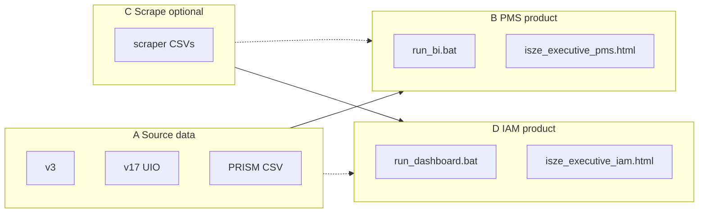

# Dashboard map — where to open what

**Read first:** `PRODUCT_LOGIC.md` — why PMS and IAM are not “scraper” products.

---

## Quick pick

| You need | Product | Open |
|----------|---------|------|
| PMS lost sales, ITUK UIO, by model, PRISM all-DB | **PMS analytics** | `run_bi.bat` → **PMS results** |
| Static PMS in browser | **PMS analytics** | `_html_previews\isze_executive_pms.html` |
| IAM T/Q, threat matrix | **IAM lookup** | `run_dashboard.bat` or `isze_executive_iam.html` |
| Scrape Autodoc/KS prices | **Competitor scrape** | Parent `run_autodoc_scraper.bat` (not PMS) |
| Old 10-tab mixed app | Legacy | `autodoc_dashboard.py` |

---

## Streamlit apps (3 products + 1 legacy)

### 1. ISZE PMS Intelligence — **use for PMS**

| | |
|--|--|
| **Product** | PMS analytics (engine + PRISM) |
| **Folder** | `_HANDOFF_BUNDLE\` |
| **Launcher** | `run_bi.bat` |
| **Code** | `bi_shell.py` + `engine.py` + `sources.yaml` |

**Tabs**

| Tab | Layer | Contents |
|-----|-------|----------|
| ISZE source files | Data (A) | v3, v17, PMS Calc preview |
| Competitor prices (optional) | Scrape (C) | CSVs — not PMS actuals |
| PMS results | PMS (B) | Sidebar scope + outputs below |

**PMS results sub-tabs**

| Sub-tab | Contents |
|---------|----------|
| Overview | Lost GP by category |
| By category | Category table |
| By model | ITUK car park + allocation |
| By PN | PN drill-down |
| Competitor brands | From scraper CSVs only (C) |
| All distributors | PRISM CSV (`N75_only`) |
| Methodology | Intervals, UIO, warnings |

---

### 2. ISZE IAM Lookup Lab — **not for PMS claims**

| | |
|--|--|
| **Product** | IAM scoring on scraped AM prices |
| **Folder** | Parent `autodoc_scraper\` |
| **Launcher** | `run_dashboard.bat` |
| **Code** | `autodoc_dashboard.py`, `iam_scoring.py` |

**Tabs:** Cockpit · PMS Lost Sales (old path) · Brand League · Threat Map · PN Deep Dive · Category Heatmap · Scenario Lab · Geography · Data Quality · Methodology

Prefer **PMS Intelligence** (above) for audited PMS and PRISM multi-DB.

---

### 3. Competitor price scraping — **no PMS / IAM dashboard**

| Script | Site |
|--------|------|
| `autodoc_scraper.py` | Autodoc UK |
| `ks_scraper.py` | KS International |
| `mekonomen_scraper.py` | Mekonomen |

Outputs: `*_results.csv` in parent or bundle. Optional input to PMS app tab **Competitor prices** and IAM scoring.

---

### 4. Legacy prototypes

| App | Launcher | Note |
|-----|----------|------|
| `competitive_bi.py` | `run_competitive_bi.bat` | Superseded by handoff PMS |
| `gps_dashboard` | `Projects\Isuzu\gps_dashboard\` | PRISM/GPS — separate project |

---

## HTML exports (browser)

**Built by:** `build_executive_dashboard.py` (parent)  
**Output:** `autodoc_scraper\_html_previews\`

| File | Product | Default? |
|------|---------|----------|
| **`isze_executive_pms.html`** | PMS analytics | **Yes** (`run_executive_html.bat`) |
| `isze_executive_iam.html` | IAM lookup | No |
| `isze_executive_dashboard.html` | Combined B+D | Avoid externally |
| `iam_matrix_*.html` | Old IAM matrices | Legacy |

```powershell
cd C:\Users\jerom\Desktop\claude\ISZE\04_tools\autodoc_scraper
python build_executive_dashboard.py --variant pms
python build_executive_dashboard.py --variant iam
python build_executive_dashboard.py --variant all
```

---

## Diagram



---

## Folder name vs product (FAQ)

**Q: Why is PMS in `autodoc_scraper`?**  
**A:** Historical repo layout. The **product** is “ISZE PMS Intelligence” in `_HANDOFF_BUNDLE`. Scraping is an optional sibling folder capability, not the name of the BI.

See `PRODUCT_LOGIC.md` for rules and `AUDIT_MAP.md` for file paths.
