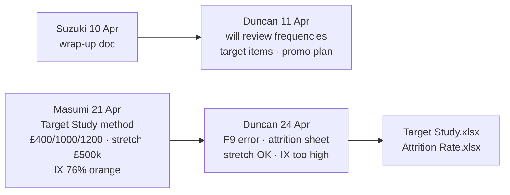

# Deep analysis — Duncan Wrap-Up thread × Target Study × Attrition × N75 PMS

**internal · Jerome only · 2026-07-26**  
Sources: Outlook verbatim (`Duncan_WrapUp_thread_verbatim_2026-04.md`) · Target Study + Attrition xlsx · N75 pack (Interval Model / CLEAR.xlsx / HTML).

---

## Executive verdict

There are **two parallel PMS tracks** in the same thread. Tomorrow’s IML meeting (27 Jul) sits on track A; Masumi’s Target Study is track B. Duncan already accepted both logics in principle — with hard caveats. Our N75 cover work **answers his Apr 11 operational ask** and **partially answers his Apr 24 “target categories / levers” ask**. It does **not** replace the £/UIO share model, and should not be sold as “his oil %”.

| Track | Owner ask | Artefact | Status vs our N75 study |
|-------|-----------|----------|-------------------------|
| **A — PMS promo ops** | Suzuki wrap-up → Duncan: review **replacement frequencies**, **target items**, **promotion plan** (for Apr 27 feedback) | Wrap-up PDF / feedback deck | **N75 study is the quantified answer** (40k oil, cover %, phase-one brake+air) |
| **B — Parts £ potential** | Masumi: align **UIO × £/unit × share × stretch** | Target Study + Attrition | **Different lens** — £ share ~77–80%, not oil cover ~40% |

Duncan’s Apr 24 reply is a **review of Masumi’s model**, not a competing cover % pack.

---

## Thread chronology (what each person actually wanted)



1. **Suzuki** — hospitality + wrap-up attachment; PMS sales promotion discussed F2F.  
2. **Duncan (11 Apr)** — commits to **frequencies → items → promo** before **27 Apr** feedback meeting.  
3. **Masumi (21 Apr)** — narrows loop to Duncan + Jerome; seeks alignment on **sales-potential method** (not yet category cover). Flags arbitrary **10%** old-cohort attrition; avoids IML **100% scrap @ 16 yrs**; green stretch ~**£500k ≈ +1% share**; PMS = *one* lever; also **other high-value categories**; orange **IX 76%**.  
4. **Duncan (24 Apr)** — detailed critique of that spreadsheet + attaches **Attrition Rate**.

---

## Point-by-point: Duncan’s Apr 24 vs the numbers

### 1. Cell F9 — N75 2024 UIO error (confirmed in the file)

| Claim (Duncan) | Check in Target Study |
|----------------|------------------------|
| F9 N75 2024 wrong | **F9 = 10,684** |
| Includes N55/N62/N75 & UNSPECIFIED | Sales Share collapses LD into “N35 / N75 / MD”; Projection sheet **separates** N50/55 (~628), N62/65 (~245), UNSPEC (~368), pure N75 (~9,506) for 2025 |
| Remove **417** UNSPECIFIED | Matches Masumi/Duncan language; Projection UNSPEC ~368 (2025) — same idea, vintage differs |

**Impact if we correct the N75 bucket (holding 2024 actual sales £12.33M fixed):**

| N75 UIO used in potential | TTL potential £ | Implied share | 1% of potential £ |
|---------------------------|----------------:|--------------:|------------------:|
| **10,684** (F9 as published) | 16.01M | **77.0%** | 160k |
| 10,684 − 417 | 15.59M | **79.1%** | 156k |
| **9,506** (Projection pure N75) | 14.83M | **83.1%** | 148k |
| **9,359** (our pilot) | 14.69M | **84.0%** | 147k |

So: F9 **overstates potential** → **understates share**. Cleaning UIO makes ITUK look *better* on share, not worse. Duncan was right that forward stretch maths move when F9 is fixed — the green **~£509k** stretch is an absolute £ from the meeting conversation, not a sacred % of a wrong parc.

**Our meeting line:** Pilot UIO = **9,359**. Target Study’s own Projection N75 ≈ **9,506** (±1.6%). Do not defend 10,684.

Full DVLA TTL **22,389** (2024) matches Sales Share F11 and our sheet 02 — no fight there.

### 2. Attrition — Masumi vs Duncan vs workbook

| Party | Position |
|-------|----------|
| **Masumi** | Pre-2010 hard; used **arbitrary 10%** cut for pre-2008 / 2008 / 2009. IML rule (**100% gone after 16 years**) → ugly 2026 parc dip. |
| **Duncan** | Re-tax foundation OK; refine with **ITUK attrition actuals** (attached sheet). Agree methodology with ISZE. |
| **Attrition Rate.xlsx** | Vintage 2010–2020: Niguri/sales vs **SMMT** still-in-parc → attrition %. Old N75 high (~77% for 2010); recent low (~4% for 2020). N35 attrition steeper than N75 at same age. |
| **Target Study Projection v17** | Pre-2008→2010 held at **90% survival** (= 10% attrition) — exactly Masumi’s arbitrary rule, now labelled override. |

**vs N75 PMS:** Cover % uses a **fixed** DVLA Method A cut (9,359). Attrition debate is about **forecast parc / £ potential**, not about reopening CY2025 oil cover tomorrow — unless someone attacks UIO credibility. If they do: point to Projection’s clean N75 (~9.5k) and our 9,359, not F9.

### 3. £/unit (£400 / £1,000 / £1,200)

Duncan: **broadly aligns** with his internal benchmarks, but assumptions heavy. Wants later segmentation by:

- **Vehicle age** (older → higher £/unit)  
- **Dealer penetration / retention**

**vs N75:** Our model is **not** £/UIO flat. It is **category demand** = UIO × (km/yr ÷ interval) × basket. That *implicitly* differs by duty cycle and interval (GIDSS 40k oil) — closer to what IML asked operationally, and closer to Duncan’s Apr 11 “replacement frequencies” than Masumi’s flat £1,000/N75.

Do **not** reconcile 40% oil cover into £1,000/unit — different denominator.

### 4. Stretch ~£500k / ~1% share

| Voice | Stance |
|-------|--------|
| Masumi | Green cells; ~£500k; ~**1% share** from 2025; PMS promo = part of levers; also other high-value cats |
| Duncan | **Realistic in principle**; F9 must be fixed; delivery needs **IML vs non-IML category ID**, **dealer execution**, **competitive PMS support**; PMS important but **not only** — chase higher-value upside too |
| Model | Stretch amount cell ≈ **£508,758**; post-stretch share path ~**80.4%** |

**vs N75 gap ~€0.65M:** Complementary commercial story, not additive.

- Stretch = *extra parts £ to win* vs £/UIO potential (network ambition).  
- N75 gap = *unserved PMS demand* on five categories inside pilot parc.  
- Saying both in one breath is fine if you label them; adding them is wrong.

Duncan’s delivery conditions map cleanly onto our pack:

| Duncan condition | Our artefact |
|------------------|--------------|
| Target categories IML vs non-IML | FIG-KEY / category cover (oil, fuel, air, brake, clutch) |
| Dealer engagement | DLR cover **46%** oil vs DB **40%** — dealer already ahead on oil |
| PMS promo support | Phase-one **brake + air** (air weak ~19% — promo candidate; brake ~62%) |
| Higher-value beyond PMS | Explicit shared/B: stay honest — N75 study is PMS-first; don’t pretend it closes all £/UIO gap |

### 5. Isuzu IX 76% (orange cells)

Masumi: flagged for awareness — IML + ISZE parts outlooks already bake it toward 2030.  
Duncan: **notably ambitious**; needs parc + competitiveness step-change + roadmap (product, network, retention).  

**Tomorrow:** If IX orange appears, stay with Duncan — don’t defend 76% from the N75 pack. N75 study is CY2025 actuals vs service schedule, not a 2030 IX bridge.

### 6. Duncan’s two asks to continue with ISZE

1. Agree **attrition methodology** (his sheet vs Masumi 10% override vs IML 16-yr cliff).  
2. Define **key levers** for the share increase.

**Our N75 pack is lever evidence for (2)** on the PMS slice. Attrition (1) is still open governance — not blocked by tomorrow, but don’t claim we closed it.

---

## How the three artefacts interlock

```text
                    ┌─────────────────────────────┐
   Attrition Rate   │ cohort survival (SMMT vs sales)│
                    └──────────────┬──────────────┘
                                   ▼
                    ┌─────────────────────────────┐
   Target Study     │ UIO forecast × £/unit        │
   (Masumi)         │ → potential → share → stretch│
                    └──────────────┬──────────────┘
                                   │  Duncan: F9 fix, attrition,
                                   │  stretch OK, IX no, levers
                                   ▼
                    ┌─────────────────────────────┐
   N75 PMS study    │ Fixed UIO 9,359 × schedule   │
   (ISZE Apr/Jul)   │ → category COVER % + € gap   │
                    └─────────────────────────────┘
         answers Duncan 11 Apr (frequencies / items)
         feeds Duncan 24 Apr (category levers / PMS)
         does NOT replace Target Study share %
```

---

## What to say tomorrow (internal → shared filter)

**If Target Study / stretch / F9 comes up (likely only if Masumi/Duncan digress):**

> We treat pilot parc as **9,359 N75**. That lines up with the Target Study’s own N75 projection (~9,500), not the Sales Share F9 bucket Duncan already flagged. Oil cover on that pilot is ~**40% DB / ~46% DLR**; phase-one is **brake + air**. The ~£500k stretch is a **total-parts share** ambition — complementary to the PMS category gap, not the same number.

**If someone conflates 77% share with 40% oil:**

> Share is total parts £ versus £-per-UIO potential. Cover is PMS category units versus service demand on the IML/GIDSS schedule. Both can be true.

**If attrition / IX comes up:**

> Attrition methodology still to agree (Duncan’s ask). IX 76% is outside this pilot pack — Duncan already called it ambitious.

**Lead with (shared):** N75 pilot · 9,359 · oil 40/46 · gap ~€0.65M · brake+air · UTI separate · no personal names.

---

## Open items from this thread (not closed by N75 study)

1. Formal **F9 / model-mix cleanup** in Target Study (Masumi + Duncan).  
2. Joint **attrition methodology** sign-off (ITUK sheet vs 10% override vs IML 16-yr).  
3. Explicit **IML vs non-IML** category map for the £500k stretch (PMS basket vs “higher-value”).  
4. Whether **£/unit** should later age-segment (Duncan ask) — optional, post-meeting.  
5. Apr 27 2026 feedback meeting outcomes — check if a written promo plan landed after Duncan’s 11 Apr commit (separate from this Target Study reply).

---

## File index

| File | Role |
|------|------|
| `Duncan_WrapUp_thread_verbatim_2026-04.md` | Full thread text |
| `ITUK_Parts_Sales_Target_Study_20260409.xlsx` | Masumi model |
| `Attrition_Rate.xlsx` | Duncan ITUK attrition |
| `../TARGET_STUDY_vs_N75.md` | Short UIO/share vs cover lineup |
| This file | Deep mail × model × N75 synthesis |
